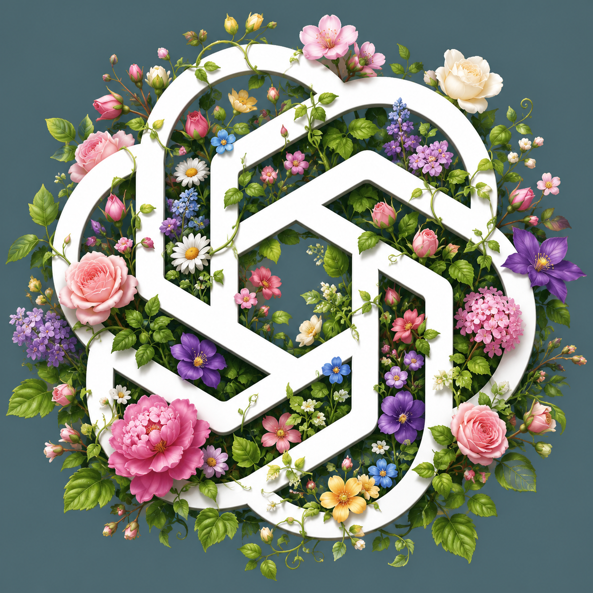
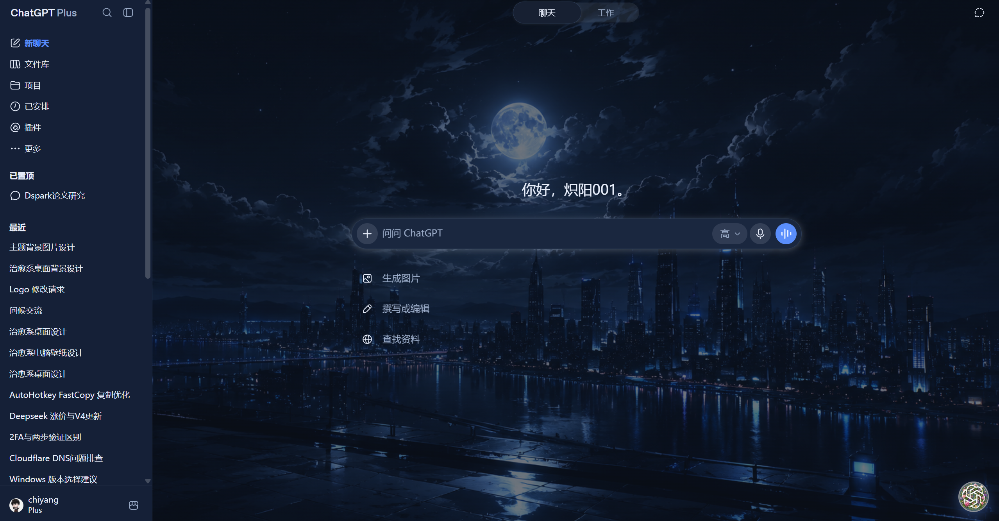
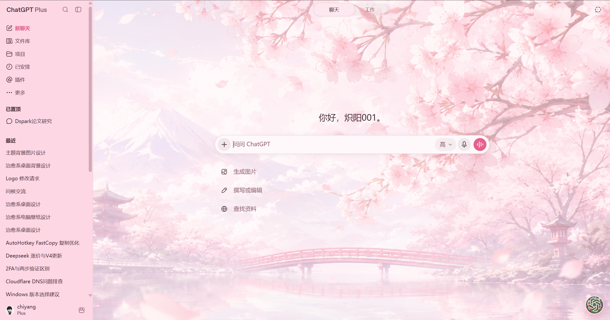
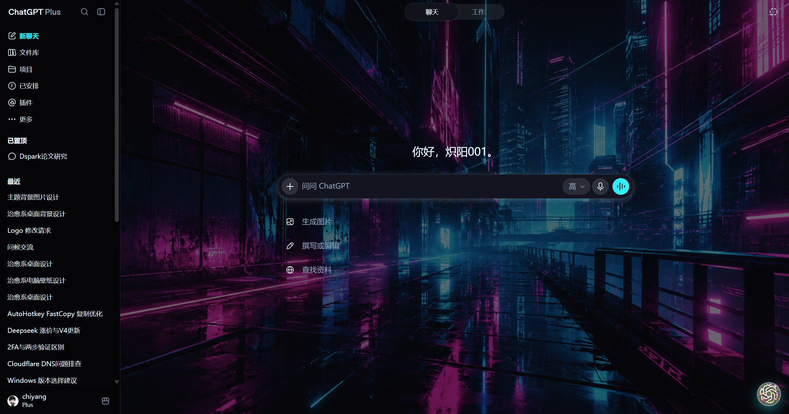
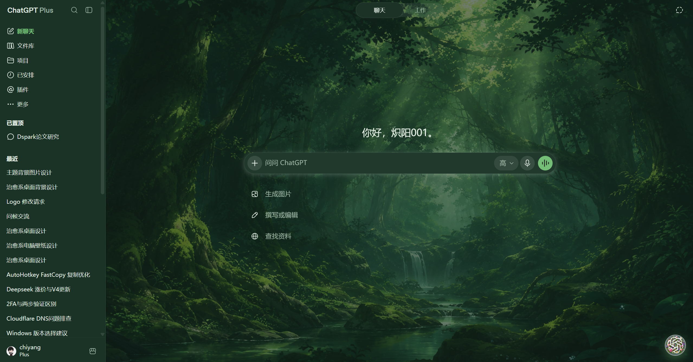
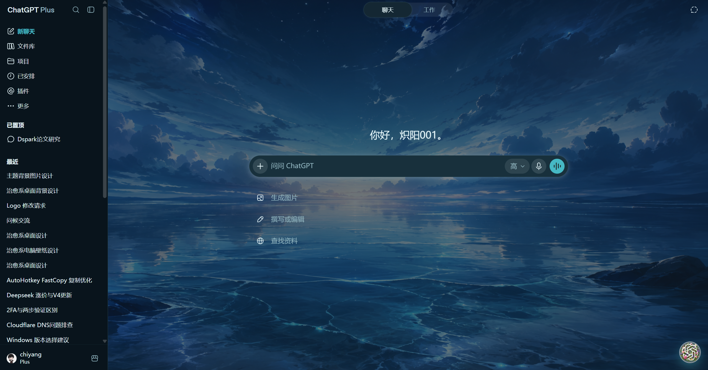
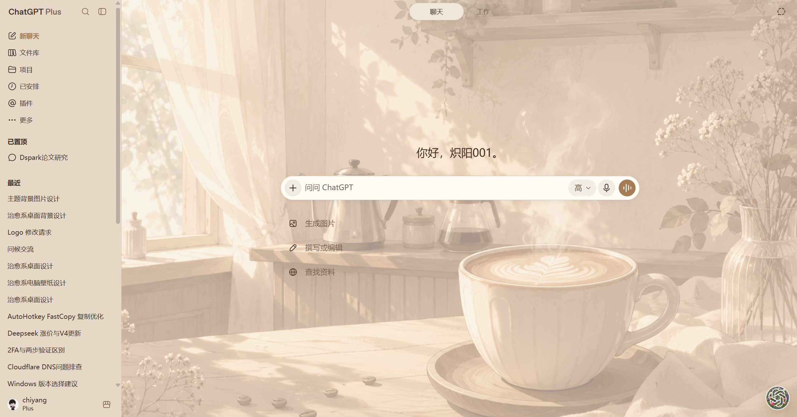
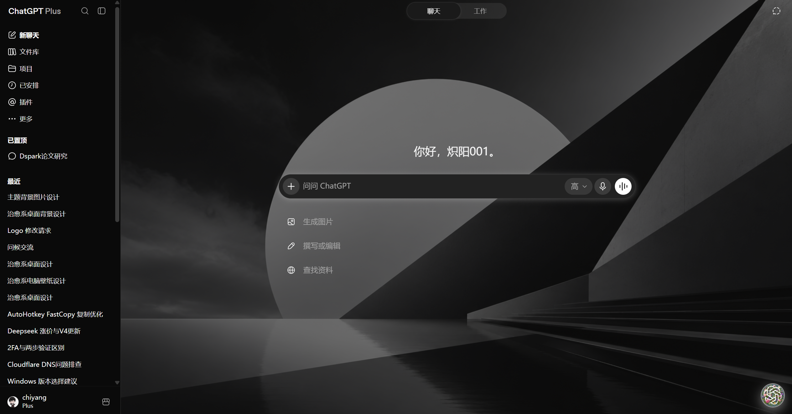
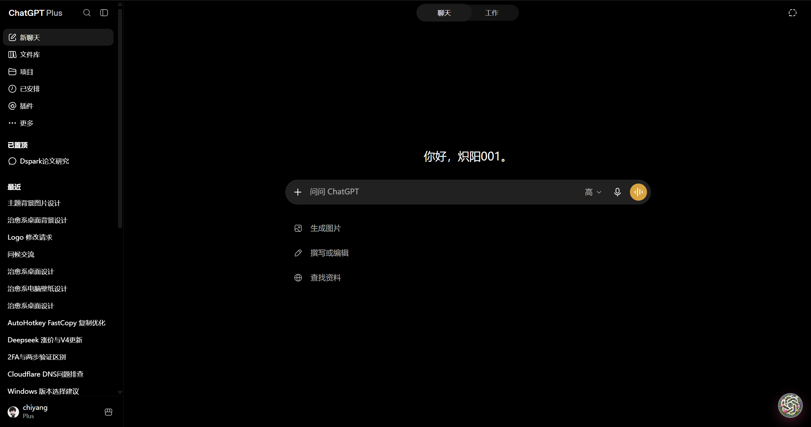

<p align="center">
  
  
  
</p>

<h1 align="center">Beauty-GPT</h1>

<p align="center">
  <b>为 ChatGPT 网页端打造的精美换肤扩展</b><br/>
  预设主题 · 自定义配色 · 图片 / 视频背景
</p>

<p align="center">
  <a href="https://space.bilibili.com/404891612"></a>
  &nbsp;
  <a href="https://github.com/Chiyang001?tab=repositories"></a>
  &nbsp;
  
</p>

---

## 简介

**Beauty-GPT** 是一款面向 [ChatGPT](https://chatgpt.com) 网页端的 Chrome 扩展。

在不影响正常对话的前提下，为界面换上更有氛围的主题与壁纸，也支持自定义图片 / 视频背景。  
由 UP 主 / 开发者 **炽阳001**（[Chiyang001](https://github.com/Chiyang001)）制作。

<p align="center">
  <code>Chrome MV3</code>
  &nbsp;·&nbsp;
  <code>chatgpt.com</code>
  &nbsp;·&nbsp;
  <code>本地持久化</code>
  &nbsp;·&nbsp;
  <code>Shadow DOM 面板</code>
</p>

---

## 效果预览

以下为不同主题与背景开启后的实际页面效果（截取自 ChatGPT 网页端）。

<table>
  <tr>
    <td align="center" width="50%">
      <br/>
      <sub><b>午夜</b> · 冷蓝夜景壁纸</sub>
    </td>
    <td align="center" width="50%">
      <br/>
      <sub><b>樱花</b> · 治愈系粉白风景</sub>
    </td>
  </tr>
  <tr>
    <td align="center" width="50%">
      <br/>
      <sub><b>赛博</b> · 霓虹都市夜景</sub>
    </td>
    <td align="center" width="50%">
      <br/>
      <sub><b>森林</b> · 深林氛围壁纸</sub>
    </td>
  </tr>
  <tr>
    <td align="center" width="50%">
      <br/>
      <sub><b>海洋</b> · 星空海岸壁纸</sub>
    </td>
    <td align="center" width="50%">
      <br/>
      <sub><b>拿铁</b> · 暖色咖啡时光</sub>
    </td>
  </tr>
  <tr>
    <td align="center" width="50%">
      <br/>
      <sub><b>极简</b> · 灰度艺术壁纸</sub>
    </td>
    <td align="center" width="50%">
      <br/>
      <sub><b>极简</b> · 纯黑沉浸模式</sub>
    </td>
  </tr>
</table>

<p align="center"><sub>也可在面板中关闭主题壁纸，或上传自定义图片 / 视频作为背景。</sub></p>

---

## 功能亮点

<table>
  <tr>
    <td width="50%" valign="top">
      <h3>预设主题</h3>
      <p>内置 8 套风格，一键切换：</p>
      <p>
        <code>默认</code>
        <code>午夜</code>
        <code>樱花</code>
        <code>赛博</code><br/>
        <code>森林</code>
        <code>海洋</code>
        <code>拿铁</code>
        <code>极简</code>
      </p>
    </td>
    <td width="50%" valign="top">
      <h3>自定义配色</h3>
      <p>主背景、侧栏、文字、强调色、输入框、用户气泡等均可调整。</p>
      <p><b>改色即预览，自动保存</b>，无需额外点击应用。</p>
    </td>
  </tr>
  <tr>
    <td width="50%" valign="top">
      <h3>聊天背景</h3>
      <p>主题配套壁纸，透明度可调。</p>
      <p>支持上传自定义 <b>图片</b> 或 <b>视频</b>（建议 mp4 / webm，≤40MB）。</p>
    </td>
    <td width="50%" valign="top">
      <h3>浮动面板</h3>
      <p>页面内可拖拽按钮，位置自动记住。</p>
      <p>Shadow DOM 隔离样式，不与 ChatGPT 原有主题互相干扰。</p>
    </td>
  </tr>
</table>

---

## 快速安装

| 步骤 | 操作 |
| :---: | --- |
| **1** | 打开 Chrome，进入 `chrome://extensions/` |
| **2** | 开启右上角 **开发者模式** |
| **3** | 点击 **加载已解压的扩展程序** |
| **4** | 选择本仓库根目录（需包含 `manifest.json`） |
| **5** | 打开 [chatgpt.com](https://chatgpt.com)，右下角出现 Beauty-GPT 按钮即可使用 |

> **开发提示**  
> 修改扩展代码后，请先在扩展管理页点击「重新加载」，再硬刷新 ChatGPT 页面。

---

## 使用指南

```text
浮动按钮 → 打开面板
   ├─ 预设主题     一键切换配色与配套背景
   ├─ 聊天背景     开关壁纸 / 调透明度 / 上传图片或视频
   ├─ 自定义配色   拖动色板，实时预览并自动保存
   └─ 拖拽按钮     长按移动位置，刷新后仍保留
```

扩展图标的弹窗仅作快捷入口；**真正的换肤操作在页面内面板完成**。

---

## 项目结构

```text
Beauty-GPT/
├── manifest.json                 # 扩展清单（MV3）
├── README.md
├── assets/
│   ├── logo.png                  # 个人 Logo
│   ├── v-divider.svg             # README Logo 分隔线
│   ├── bilibili-color.svg        # B站图标
│   ├── github.svg                # GitHub 图标
│   ├── badge-*.svg               # README 社交徽章
│   ├── examples/                 # 主题效果截图
│   └── themes/                   # 各主题壁纸
├── icons/
│   └── logo.png                  # 软件 Logo / 扩展图标
└── src/
    ├── background.js             # Service Worker（视频分片存储）
    ├── content.js                # 面板 UI 与交互
    ├── theme-engine.js           # 主题引擎与壁纸逻辑
    ├── themes.json               # 预设主题定义
    ├── bg-player.html / .js      # 视频背景播放辅助
    ├── styles/                   # 注入样式与面板样式
    └── popup/                    # 扩展弹窗
```

---

## 权限说明

| 权限 | 范围 | 用途 |
| --- | --- | --- |
| `storage` | 扩展本地 / 同步存储 | 保存主题、壁纸设置与按钮位置 |
| Host | `chatgpt.com` / `chat.openai.com` | 仅在 ChatGPT 网页注入换肤能力 |

本扩展**不会**请求其它无关站点权限。

---

## 作者与联系

<p align="center">
  <br/><br/>
  <b>炽阳001</b>（Chiyang001）
</p>

<p align="center">
  <a href="https://space.bilibili.com/404891612"></a>
  &nbsp;
  <a href="https://github.com/Chiyang001?tab=repositories"></a>
</p>

| | |
| --- | --- |
| QQ | `3083248889` |
| 邮箱 | [`3083248889@qq.com`](mailto:3083248889@qq.com) |

欢迎关注、Star，以及反馈使用中的问题与建议。

---

## 兼容性说明

ChatGPT 前端 DOM 会不定期变化。主题通过高优先级 CSS 变量与区域选择器覆盖实现。

若某次站点改版导致局部失效，可在：

```text
src/theme-engine.js  →  generateThemeCss()
```

中补充对应选择器。

---

## 开发验证

### v1.3.0

移除健康页示例图的独立渐变遮罩、财务/GPT 共用顶栏的伪元素填充；限制高亮规则只作用于真正的菜单项，避免 `data-highlighted="false"` 的滑条外层出现矩形背景。保留健康示例卡、图表、GPT 通知卡及滑钮原生尺寸，并覆盖壁纸关闭后的恢复。

修正消息外层的错误染色。实际页面使用 `data-submit-message-animation-target` 作为全宽外层，真正气泡位于数层 hydration 容器内并带有 `data-user-message-bubble`。现在只给后者上色，并清理外层旧的内联填充；回归使用实际嵌套结构，确认修复后外层及操作区保持透明。

补齐未登录对话 `data-message-role="user"` 的用户气泡背景与文字对比度，使已有消息和新挂载消息跟随“用户气泡”配色；保留原生圆角及消息外层、操作区和助手回复的背景。

根据实际未登录设置页补齐 `mobile-settings-page` 的文字、说明、选择值、分组和返回入口配色，适配 `input[role=switch]` 的轨道及 `::after` 滑钮。新增设置页回归，覆盖 390px/1440px、7 套主题及原始开关值、select 透明覆盖层、隐藏面板的保留。

将未登录主题检测扩展到没有聊天输入框的图像和插件等页面；修复 ChatGPT 选择入口的悬停底色、试用卡片登录按钮的双层描边，以及窄窗口侧栏内登录卡片和底部设置区域的黑底/渐变。回归覆盖 390px、1440px 与 7 套主题。

补修未登录首页的图标按钮：移除加号、听写、语音通话和左上角侧栏按钮的常驻边框、圆形填充及伪元素填充；保留按钮尺寸、图标对比度和登录/发送按钮样式。

统一更新图片/视频背景的图层与加载状态、输入框操作区、搜索框、设置和资料编辑面板的主题兼容性；修复插件、资料库等页面顶栏加载时的填充闪烁。保留原生控件布局、图表颜色和隐藏路由状态，支持窄窗口下悬浮按钮自动避让输入框。

补齐退出登录后轻量首页的独立控件样式：移除壁纸上的顶部黑色渐变和输入框下方横条，统一登录/注册、语音/发送、建议按钮、侧栏和隐私文字的配色，适配登录弹层及邮件输入框。保留站点自身的弹层开关、隐藏文件选择器和控件尺寸。

1.2.14 修复插件和资料库切换时顶栏闪白：顶栏清理在 MutationObserver 回调中立即执行，不再等待通用样式修复的 160ms 延迟；覆盖 main 之外、尚未挂载标题/搜索框的占位顶栏和装饰背景层。集成测试逐帧检查这两个路由的加载、延迟内容挂载和容器替换；禁用即时修复时，该测试可在第 0 帧复现白底。

安装 Node.js、Playwright 和对应 Chromium 后，在项目根目录运行：

```sh
node tools/verify-theme-compat.cjs
node tools/verify-extension.cjs
node tools/verify-live-structures.cjs
node tools/verify-surface-regressions.cjs
node tools/verify-library-topbar.cjs
node tools/verify-logged-out.cjs
node tools/verify-logged-out-settings.cjs
node tools/verify-feature-overlays.cjs
```

第一组检查主题、设置页、浮层、引用胶囊和滑条的样式兼容性。第二组使用临时配置加载真实 MV3 扩展，在本地模拟的 ChatGPT 页面上验证 7 套预设图片的解码和画面像素、背景强度、开关持久化、SPA 样式恢复、输入框布局、配色与窄窗口面板。它不访问登录账户，不能代替当前线上页面的人工复验。测试截图保存在 `tools/test-results/`。

1.2.6 的背景使用独立 Shadow DOM 图层，不再依赖 `html::before` 的负层级。测试还覆盖无稳定类名的聊天滚动容器、原生 `!important` 背景重绘、装饰伪元素遮挡及背景图层被删除后的恢复。面板会分别提示图片正在加载、已加载、加载失败，以及背景强度为 0% 的隐藏状态。

1.2.9 根据 2026-10-31 真实登录页面检查补齐：新版思考滑条的可见滑块和填充条、DIL 引用胶囊、设置开关与颜色样本、侧栏选中图标、复合搜索栏、存储进度条和标题栏按钮容器。保留图表的语义颜色，按钮文字、侧栏文字按 WCAG 对比度选择前景色。第三组测试使用这些真实 DOM 结构，还验证切主题及恢复默认时不会删除站点自身的 `display`、`opacity`、圆角等内联属性，避免隐藏路由和旧输入框被显示出来。

1.2.10 补充真实 390px 窄窗口检查发现的悬浮按钮遮挡：当主题按钮与输入框重叠时自动移到输入框上方，拖动结束、窗口变化和页面更新时重新检查；不改写保存位置，除非用户主动拖动。

1.2.11 根据用户新增的 12 项截图修复：滑条只为最内层圆形滑钮上色，清除动画外壳的矩形背景；统一去掉搜索输入框内部白块和聚焦外圈，覆盖语言菜单和 Codex 云端；个人资料编辑面板清除黑底并统一文字颜色，开关外壳透明；移除 Token 活动、减少动态效果和壁纸模式下资料空间、图像、站点、Drive 列表的中性大块填充。第四组测试在 7 套预设中验证这些样式及壁纸开关恢复，保留图表单元格、加载占位和文稿预览的颜色。这些是本地 Chromium 回归结果，1.2.11 的线上页面复验尚未完成。

1.2.12 修复资料空间页顶栏在壁纸上方露出白色/主题色填充条的问题：新版全页视图的标题、搜索与「创建」栏位于 `main` 之外，原先的主列清理无法命中。现在按页面路由与顶栏锚点标记该栏及其同尺寸外壳，仅在壁纸模式清空背景并保留内联样式快照，关闭壁纸或离开该路由时完整还原；新增 `tools/verify-library-topbar.cjs` 覆盖 7 套预设、壁纸开关、路由切换和默认主题。

本轮真实浏览器走查覆盖聊天/工作首页、短对话与长对话、模型滑条、附件菜单、来源浮层、资料空间列表及筛选、定时任务空状态、插件与技能目录，以及常规、外观、通知、语音、个性化、键盘、存储、归档、虚拟宠物和插件管理设置。另逐一切换了 7 套预设主题，确认每次只有一个可见输入框，并检查了 390px 窄窗口。验证记录与真实页面截图保存在 `tools/test-results/live-audit/`；账号权限、支付和外部服务等分支不属于本轮已走查范围。

更新本地扩展代码后，先在 Chrome 扩展管理页重新加载 Beauty-GPT，再刷新 ChatGPT 标签页；已打开页面中的旧脚本不会随磁盘文件自动更新。

---

## License

本项目仅供**学习与个人美化**使用。

请遵守 ChatGPT / OpenAI 服务条款，以及 Bilibili、GitHub 等平台相关规定。
